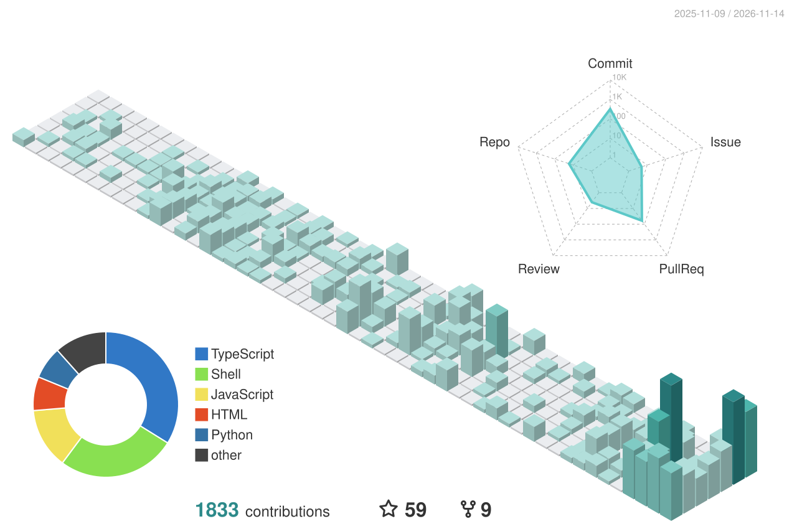

<picture>
  <source media="(prefers-color-scheme: dark)" srcset="https://raw.githubusercontent.com/yarikleto/yarikleto/main/header-dark.svg?v=4" />
  <source media="(prefers-color-scheme: light)" srcset="https://raw.githubusercontent.com/yarikleto/yarikleto/main/header-light.svg?v=4" />
  
</picture>

<picture>
  <source media="(prefers-color-scheme: dark)" srcset="https://raw.githubusercontent.com/yarikleto/yarikleto/main/contrib-dark.svg" />
  <source media="(prefers-color-scheme: light)" srcset="https://raw.githubusercontent.com/yarikleto/yarikleto/main/contrib-light.svg" />
  
</picture>

<picture>
  <source media="(prefers-color-scheme: dark)" srcset="https://raw.githubusercontent.com/yarikleto/yarikleto/main/profile-3d-contrib/profile-teal-dark.svg" />
  <source media="(prefers-color-scheme: light)" srcset="https://raw.githubusercontent.com/yarikleto/yarikleto/main/profile-3d-contrib/profile-teal.svg" />
  
</picture>
