<picture>
  <source media="(prefers-color-scheme: dark)" srcset="https://raw.githubusercontent.com/yarikleto/yarikleto/main/header-dark.svg?v=3" />
  <source media="(prefers-color-scheme: light)" srcset="https://raw.githubusercontent.com/yarikleto/yarikleto/main/header-light.svg?v=3" />
  
</picture>

  <b>Senior Software Engineer, ex-Wix</b> 
  <a href="https://www.linkedin.com/in/yarik-leto">LinkedIn</a> · <a href="https://yarikleto.github.io">Portfolio</a>

<picture>
  <source media="(prefers-color-scheme: dark)" srcset="https://raw.githubusercontent.com/yarikleto/yarikleto/output/github-snake-dark.svg?v=4" />
  <source media="(prefers-color-scheme: light)" srcset="https://raw.githubusercontent.com/yarikleto/yarikleto/output/github-snake.svg?v=4" />
  
</picture>
